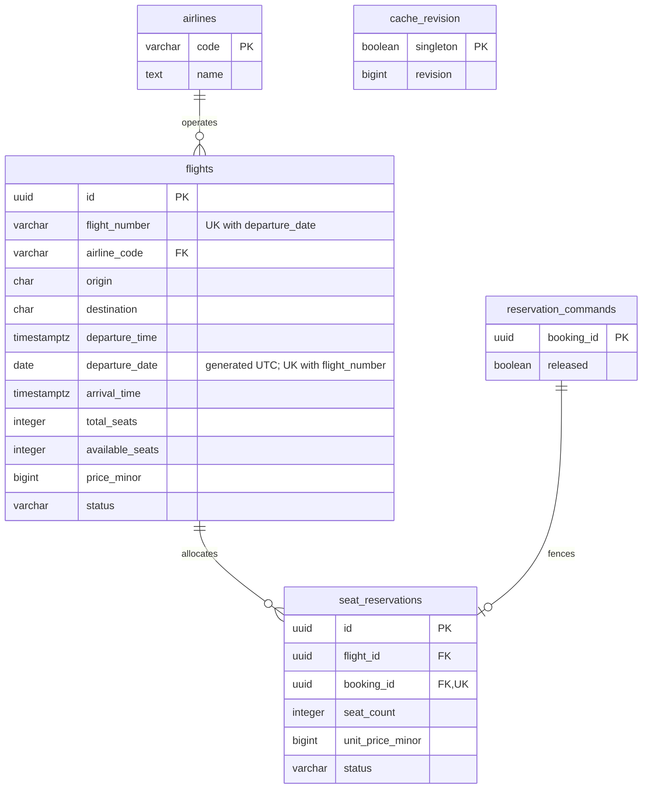

# Flight Booking

Система бронирования авиабилетов с двумя сервисами: Booking Service предоставляет REST API, Flight Service управляет рейсами и местами по gRPC. У каждого сервиса своя PostgreSQL. Redis кеширует рейсы и результаты поиска, Sentinel обеспечивает переключение мастера.

**Стек:** Kotlin, Java 17, Spring Boot, Spring JDBC, Flyway, gRPC / Protobuf, PostgreSQL, Redis / Lettuce.

## Запуск

Требуются Podman и Compose-провайдер:

```bash
podman compose up --build
```

Для Docker — `docker compose up --build`. Миграции и начальные данные применяются автоматически. Порты, пароли и сервисный ключ можно переопределить через `.env`; параметры перечислены в [.env.example](.env.example).

| Сервис | Адрес |
| --- | --- |
| Booking REST API | `http://localhost:8080` |
| Flight gRPC API | `localhost:9090` |
| PostgreSQL Flight | `localhost:55441` |
| PostgreSQL Booking | `localhost:55442` |

## API

| Метод | Назначение |
| --- | --- |
| `GET /flights?origin=SVO&destination=LED&date=YYYY-MM-DD` | Поиск рейсов; дата необязательна |
| `GET /flights/{id}` | Информация о рейсе |
| `POST /bookings` | Создание бронирования |
| `GET /bookings/{id}` | Получение бронирования |
| `GET /bookings?user_id=demo-user` | Бронирования пользователя |
| `POST /bookings/{id}/cancel` | Отмена бронирования и возврат мест |

Примеры запросов — [requests.http](requests.http), gRPC-контракт — [flight.proto](flight-contract/src/main/proto/flight.proto). Межсервисные вызовы используют metadata `x-api-key` со значением `GRPC_API_KEY`.

Денежные поля `_minor` содержат целые копейки (RUB), даты трактуются в UTC. Стоимость фиксируется при бронировании. Резервирование и возврат мест транзакционны; повторные gRPC-запросы с тем же `booking_id` безопасны. Для временных сбоев предусмотрены retry, Circuit Breaker и сохраняемые операции компенсации.

## Схема данных

Базы сервисов независимы. Связи `flight_id` и `booking_id` между сервисами логические, без межбазовых внешних ключей.

### Flight DB



### Booking DB

```mermaid
erDiagram
    bookings ||--o| cancellation_intents : recovers
    bookings {
        uuid id PK
        varchar user_id
        uuid flight_id "logical gRPC reference"
        varchar passenger_name
        varchar passenger_email
        integer seat_count
        bigint total_price_minor
        varchar status
        timestamptz created_at
    }
    reservation_cleanup {
        uuid booking_id PK
        timestamptz created_at
    }
    cancellation_intents {
        uuid booking_id PK,FK
        timestamptz created_at
    }
```



Описание ограничений и нормализации — [ER-диаграмма](docs/er-diagram.md). Устройство транзакций и кеша — [архитектура](docs/architecture.md).

## Тесты

Для модульных тестов нужна Java 17:

```bash
./gradlew test
```

Интеграционные тесты включаются через `FLIGHT_TEST_DB_URL` и `BOOKING_TEST_DB_URL`; учётные данные задаются переменными `FLIGHT_TEST_DB_USER`, `FLIGHT_TEST_DB_PASSWORD`, `BOOKING_TEST_DB_USER`, `BOOKING_TEST_DB_PASSWORD`. Используются отдельные тестовые базы.
