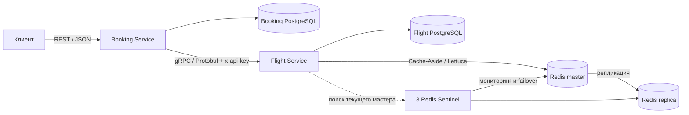
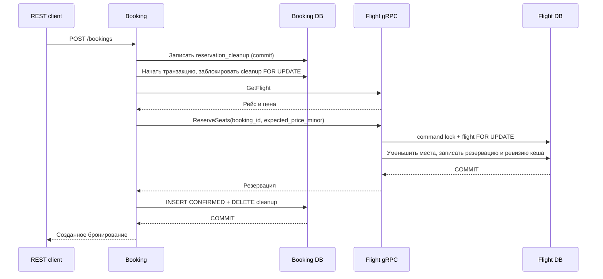

# Архитектура и согласованность

## Границы сервисов

Booking Service владеет данными пассажира, ценовым снимком и состоянием бронирования. Flight Service владеет рейсами и доступностью мест. Связь по `flight_id`/`booking_id` между базами логическая: межбазовых SQL JOIN и внешних ключей нет.

Внутри одной базы действуют обычные транзакции PostgreSQL. Общей ACID-транзакции двух баз и сетевого вызова нет. Для незавершённого создания бронирования используется сохраняемая операция компенсации.

## Создание бронирования

Идентификатор бронирования формируется до вызова Flight. `GetFlight` определяет цену для снимка. В `ReserveSeats` передаётся ожидаемая цена, которую Flight сверяет с текущей ценой под блокировкой рейса. Если между чтением и резервированием цену изменили, операция завершается `FAILED_PRECONDITION`: клиент не получает неожиданную стоимость.

В Flight уменьшение `available_seats`, создание `SeatReservation` и изменение ревизии кеша выполняются в одной транзакции. `SELECT FOR UPDATE` сериализует конкурирующие бронирования конкретного рейса. Последнее место достаётся одному запросу, остальные получают `RESOURCE_EXHAUSTED`.

`total_price_minor = seat_count * unit_price_minor` хранится как снимок. Используются целочисленные копейки, проверяется положительность и переполнение; вычислений цены через `Double` нет.

## Потерянные ответы и компенсация

Сетевой timeout не означает, что удалённая операция не выполнилась. Поэтому `ReserveSeats` идемпотентен по `booking_id`. При повторе с теми же параметрами Flight возвращает ту же резервацию. Повтор с другим рейсом или числом мест отклоняется.

Для сериализации операций одного `booking_id` Flight блокирует строку `reservation_commands`. Эта блокировка работает и для запросов с разными `flight_id`, поэтому повтор не может создать две резервации на разных рейсах.

До сетевых вызовов Booking фиксирует строку `reservation_cleanup` отдельной транзакцией. Основная транзакция удерживает её блокировку до сохранения `CONFIRMED` и удаления cleanup. При неуспехе основная транзакция откатывается, а cleanup остаётся. Booking пытается освободить резерв сразу; если вызов невозможен или процесс завершился, сохранённую запись обрабатывает фоновый reconciler.

Reconciler выбирает достаточно старые операции с `FOR UPDATE SKIP LOCKED`. Активное создание удерживает блокировку, поэтому фоновая задача пропускает его. Cleanup удаляется только после успешного `ReleaseReservation`. Восстановление не создаёт бронирование за клиента, получившего ошибку: оно освобождает потенциально оставшиеся места.

`ReleaseReservation` идемпотентен и сохраняет запрет повторного резервирования (`released` в `reservation_commands`) даже для неизвестного `booking_id`. Это закрывает гонку: компенсация может прийти раньше задержавшегося `ReserveSeats`. При любом порядке запросов освобождённый идентификатор уже не получит активный резерв.

Если Booking DB недоступна до записи cleanup, сетевое резервирование не начинается. Если процесс прекращается после резервирования, но до коммита Booking DB, cleanup остаётся и будет обработан после восстановления зависимостей. В этот промежуток резерв может временно уменьшать доступность рейса; это ожидаемая eventual consistency, а не межсервисный ACID.

## Отмена

Booking сначала фиксирует `cancellation_intents` для существующего бронирования. Затем блокирует запись бронирования, вызывает `ReleaseReservation`, меняет статус на `CANCELLED` и удаляет intent в своей транзакции. Flight под блокировкой команды и резервации возвращает места и меняет статус резервации на `RELEASED` одной транзакцией.

При потере ответа повтор безопасен: повторный release не увеличивает количество мест. Если Booking не успел сохранить `CANCELLED`, оставшийся `cancellation_intents` обрабатывает фоновый reconciler; клиент также может повторить отмену. Сервис повторно освобождает резерв без дополнительных изменений и фиксирует свой статус. Повторная отмена уже отменённого бронирования возвращает его текущее состояние.

## Кеш Redis

Кешируются `GetFlight` и `SearchFlights` по стратегии Cache-Aside. Все ключи имеют ограниченный TTL; попадания и промахи видны в логах. Redis служит ускорением чтения, PostgreSQL остаётся источником истины и единственным местом проверки доступности при записи.

Ключи включают текущую ревизию данных. Мутация увеличивает ревизию в той же PostgreSQL-транзакции, что изменяет данные. Читатель получает текущую ревизию перед обращением к Redis. После коммита мутации следующие чтения используют новое пространство ключей; старые записи больше не участвуют в ответах и исчезают по TTL.

Это предотвращает восстановление устаревшего значения при гонке «cache miss → чтение БД → параллельная мутация → запись кеша». Ключ со старой ревизией может быть записан позже, но новый читатель уже не использует его. По той же причине старый Redis-кеш не становится актуальным после временного отключения Redis.

Цена такого подхода — небольшой запрос ревизии в PostgreSQL при каждом кешируемом чтении. Кеш уменьшает чтение полных объектов и результатов поиска, но не делает чтения независимыми от БД. Обновление любого рейса меняет общее пространство ключей, поэтому при частых мутациях доля попаданий уменьшается. Для учебной системы это осознанный выбор простой согласованности.

При недоступности Redis чтение идёт в PostgreSQL. Инвалидация не зависит от успешности сетевой операции Redis. Данные после failover читаются у мастера, чтобы отставание реплики не возвращало старые сведения.

## Redis Sentinel

Compose запускает один master, одну replica и три Sentinel. Sentinel согласуют выбор нового мастера при отказе прежнего; клиент Lettuce узнаёт актуальный адрес через Sentinel. Три Sentinel обеспечивают большинство для принятия решения и позволяют продемонстрировать потерю одного наблюдателя.

Все процессы находятся на одной машине: это демонстрация отказа контейнера, а не защита от потери всего хоста. Redis-репликация асинхронна. Потеря кеша не приводит к потере бронирований, поскольку они находятся в PostgreSQL. После переключения кеш постепенно заполняется заново.

## Retry и Circuit Breaker

Обёртка gRPC-клиента отделена от бизнес-логики Booking. Retry разрешён только для `UNAVAILABLE` и `DEADLINE_EXCEEDED`. Всего не более трёх попыток, паузы перед вторым и третьим вызовом растут экспоненциально: по умолчанию 100 и 200 мс. Три попытки означают две паузы; последовательность 100/200/400 мс из условия является примером роста, а не требованием четвёртой попытки.

`INVALID_ARGUMENT`, `NOT_FOUND`, `RESOURCE_EXHAUSTED`, `FAILED_PRECONDITION` и ошибки аутентификации автоматически не повторяются. На каждую попытку установлен deadline. Повтор мутации использует тот же `booking_id`.

Circuit Breaker охватывает логический вызов с его retry. Он учитывает технические сбои `UNAVAILABLE`, `DEADLINE_EXCEEDED`, `INTERNAL`, `UNKNOWN`, `DATA_LOSS`; ожидаемые бизнес-ошибки не открывают цепь. В `CLOSED` запросы проходят; при достижении настроенного порога в окне breaker переходит в `OPEN`. В `OPEN` немедленно возвращается HTTP 503. После интервала ожидания в `HALF_OPEN` допускается один пробный вызов; успех возвращает `CLOSED`, технический сбой — `OPEN`. Параллельные пробные вызовы не допускаются. Переходы логируются, настройки передаются через окружение.

## Границы реализации

- Внешняя аутентификация пользователей и проверка владения `user_id` не входят в задание. Этот API не следует считать готовым публичным сервисом продажи билетов.
- gRPC в локальной контейнерной сети использует plaintext и API key. Ключ проверяет сервис, но не шифрует трафик; для развёртывания за пределами локальной сети требуется TLS.
- Бронирование учитывает количество мест, а не конкретные кресла, тарифные классы или платежи.
- Статус резервации `EXPIRED` предусмотрен контрактом. Обычные подтверждённые резервации автоматически не истекают: TTL Redis относится только к кешу.
- Нет общей транзакции PostgreSQL + gRPC. Неуспешное создание восстанавливается компенсацией, которая может ждать доступности зависимостей.
- Идемпотентность gRPC по `booking_id` не означает идемпотентность повторных пользовательских `POST /bookings`: новый HTTP-запрос создаёт новый идентификатор.
- `UpdateFlight` — дополнительная административная gRPC-операция с тем же сервисным ключом. Изменение цены не пересчитывает старые бронирования; изменение статуса само по себе не отменяет их.
- Конкретные даты рейсов трактуются в UTC. Поддержка временных зон аэропортов потребовала бы отдельной модели.

## REST-ошибки

Ответ ошибки имеет форму `{"code":"RESOURCE_EXHAUSTED","message":"..."}`. Детали сбоев инфраструктуры записываются в серверные логи; клиент получает краткое сообщение.

| Ситуация | HTTP | `code` |
| --- | --- | --- |
| Невалидный JSON, обязательное поле, UUID, IATA или дата | 400 | `INVALID_ARGUMENT` |
| Рейс не найден | 404 | `NOT_FOUND` |
| Бронирование не найдено | 404 | `BOOKING_NOT_FOUND` |
| Не хватает мест | 409 | `RESOURCE_EXHAUSTED` |
| Рейс недоступен, изменилась цена или несовместимый повтор | 409 | `FAILED_PRECONDITION` |
| Ошибка сервисного ключа Flight | 502 | `UNAUTHENTICATED` |
| Временно недоступен Flight | 503 | `UNAVAILABLE` |
| Закончился deadline Flight | 504 | `DEADLINE_EXCEEDED` |
| Circuit Breaker открыт | 503 | `CIRCUIT_OPEN` |
| Недоступна Booking DB | 503 | `DATABASE_UNAVAILABLE` |

Ошибка сервисного ключа отображается в 502, поскольку это ошибка конфигурации взаимодействия сервисов, а не отсутствие пользовательского входа в REST API. Создание бронирования возвращает 201 и `Location`; остальные успешные операции — 200. Списки рейсов и бронирований возвращаются JSON-массивами.
