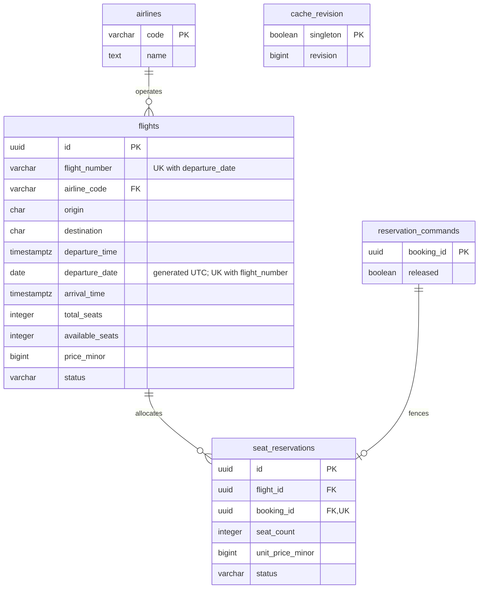
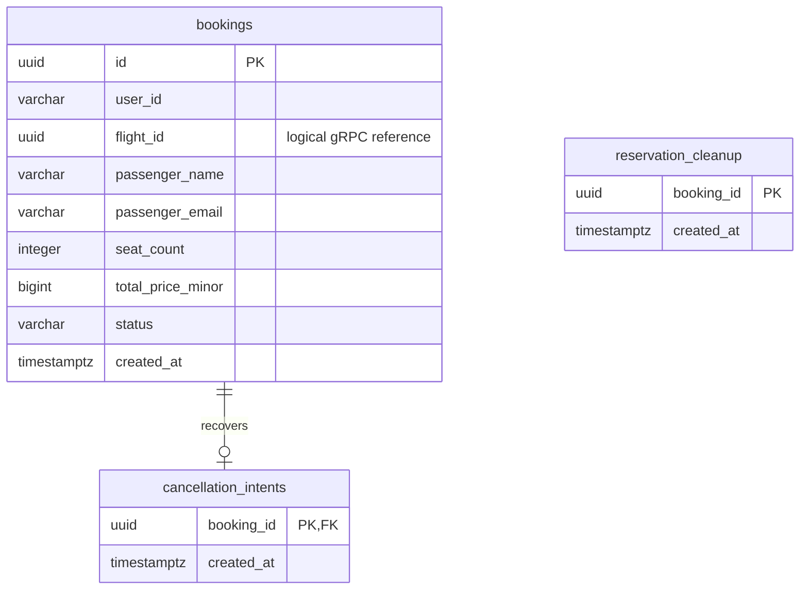

# ER-диаграмма и нормализация

Схемы принадлежат разным PostgreSQL. Линии на диаграммах ниже обозначают реальные внешние ключи внутри одной базы. `bookings.flight_id` ссылается на рейс только на уровне gRPC-контракта, а не SQL FK.

## Flight DB

`reservation_commands` может существовать без резервации: это запрет будущего резервирования после компенсации, дошедшей раньше задержанного `ReserveSeats`. У команды не более одной резервации благодаря `UNIQUE(booking_id)`.

`cache_revision` — единственная техническая строка со значением `singleton = true`. Ревизия увеличивается транзакционно при изменении данных рейсов и используется в ключах кеша.

Миграции: [схема](../flight-service/src/main/resources/db/migration/V1__flight_schema.sql), seed-данные находятся в следующих миграциях Flight Service.

## Booking DB

`reservation_cleanup` сохраняется до удалённого резервирования, когда строки `bookings` ещё нет. Поэтому у неё намеренно нет FK к `bookings`. Запись удаляется вместе с коммитом созданного бронирования либо после успешной компенсации.

`cancellation_intents` существует только для уже созданного бронирования, поэтому имеет FK. Она позволяет завершить отмену после сбоя локальной БД, случившегося после удалённого возврата мест.

Миграция: [V1__bookings.sql](../booking-service/src/main/resources/db/migration/V1__bookings.sql).

## Почему 3NF

- Значения полей атомарны: одна строка описывает один рейс, одну резервацию или одно бронирование; списков пассажиров/рейсов в колонках нет.
- Все неключевые бизнес-атрибуты относятся к целому ключу своей сущности. Первичные ключи — UUID либо код авиакомпании.
- Название авиакомпании вынесено в `airlines`: зависимость `airline_code → name` не дублируется в каждом рейсе. В `flights` остаётся FK на код.
- Цена бронирования — исторический снимок, поэтому она не определяется текущей ценой в другой таблице. Аналогично `seat_reservations.unit_price_minor` фиксирует стоимость в момент резервирования.
- `user_id` — внешний идентификатор; `passenger_name` и `passenger_email` относятся к пассажиру конкретного бронирования. Они не моделируют изменяемый профиль пользователя и не определяются `user_id`: пользователь может бронировать для другого пассажира.
- `available_seats` поддерживается как транзакционный счётчик для блокировки и проверки доступности. Он не дублирует атрибут другого объекта; его согласованность с активными резервациями обеспечивает код одной транзакции.

`departure_date` — физически сохраняемое вычисляемое представление календарного дня из `departure_time`. Его нельзя изменить независимо; оно нужно для ограничения `UNIQUE(flight_number, departure_date)` и индекса поиска. Нормализованная логическая модель использует время вылета, а PostgreSQL обслуживает этот технический столбец автоматически.

## Ограничения целостности

| Данные | Ограничение |
| --- | --- |
| Рейс | `UNIQUE(flight_number, departure_date)` |
| Места рейса | `total_seats > 0`, `0 <= available_seats <= total_seats` |
| Стоимость | `price_minor > 0`, `unit_price_minor > 0`, `total_price_minor > 0` |
| Резервация и бронирование | `seat_count > 0` |
| Аэропорты | Три заглавные латинские буквы, `origin <> destination` |
| Расписание | Прилёт позже вылета, время в диапазоне protobuf `Timestamp` |
| Резервация | Один `booking_id` встречается не более одного раза; FK на рейс и команду |
| Статусы | `CHECK` с допустимыми значениями для каждой сущности |
| Авиаоператор | FK `flights.airline_code → airlines.code` |
| Отмена | FK `cancellation_intents.booking_id → bookings.id` |

В модели нет FK между PostgreSQL. Корректность межсервисных изменений обеспечивают gRPC-операции, идемпотентность и сохраняемые компенсации. Отдельные индексы ускоряют поиск запланированных рейсов и получение бронирований пользователя.
